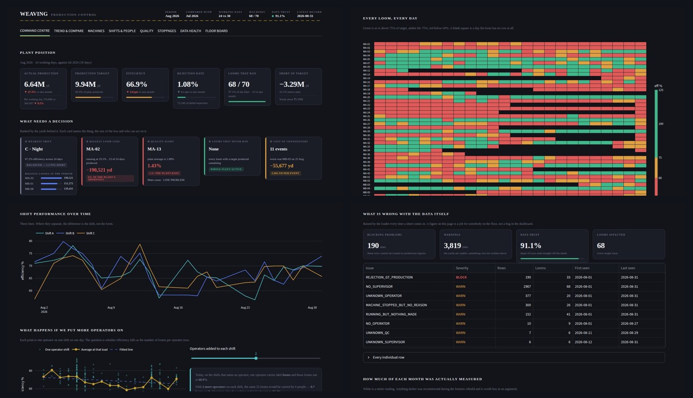
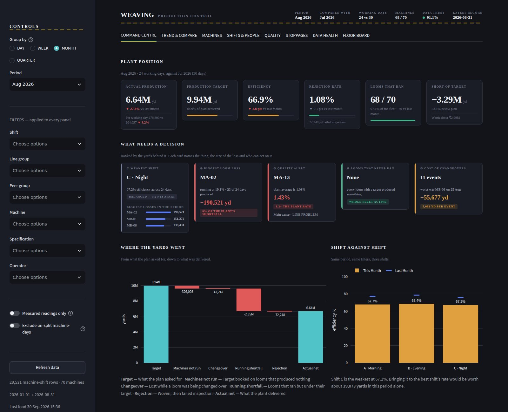
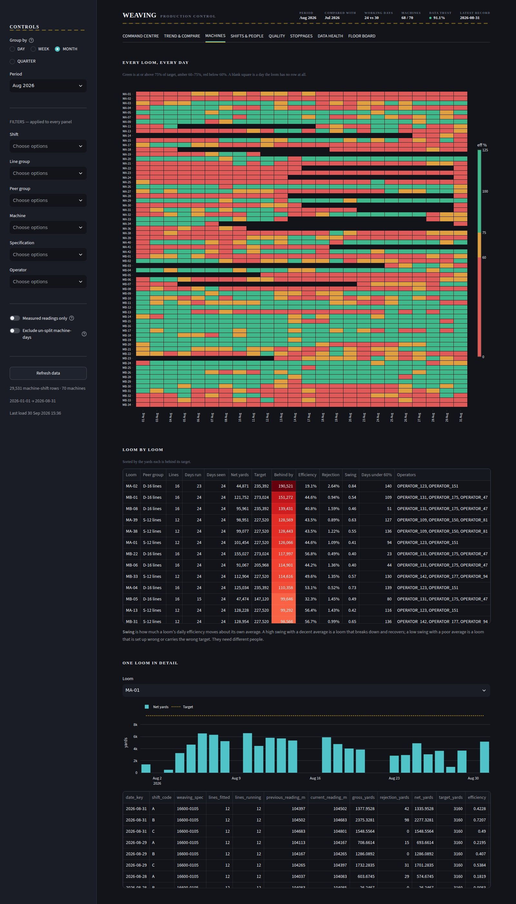
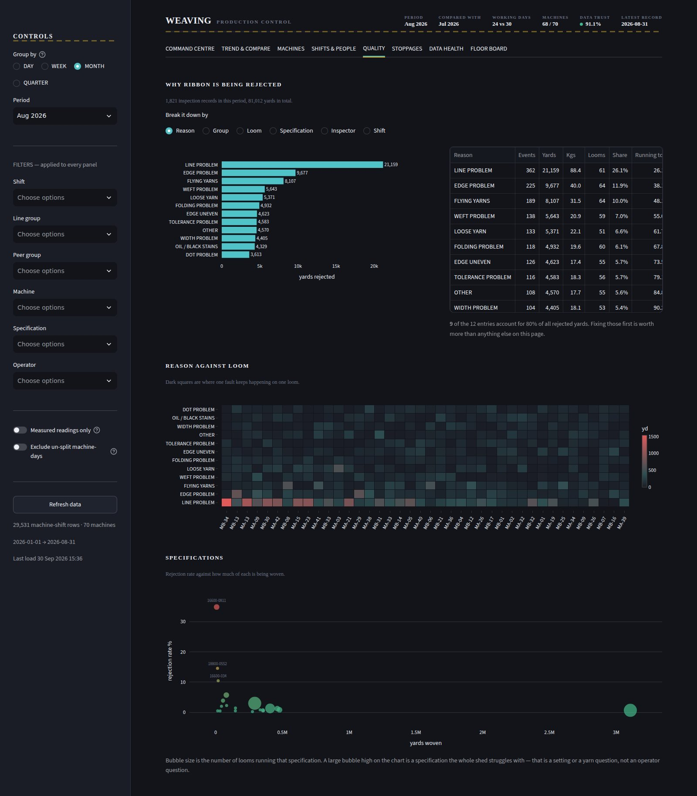
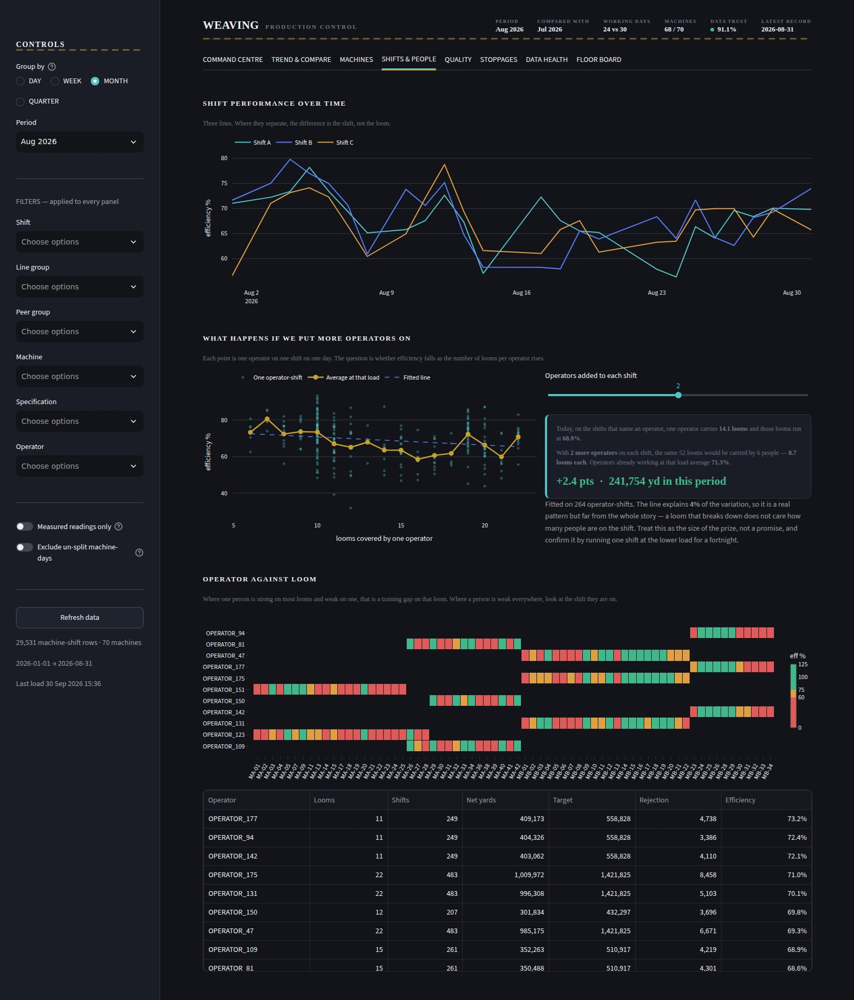
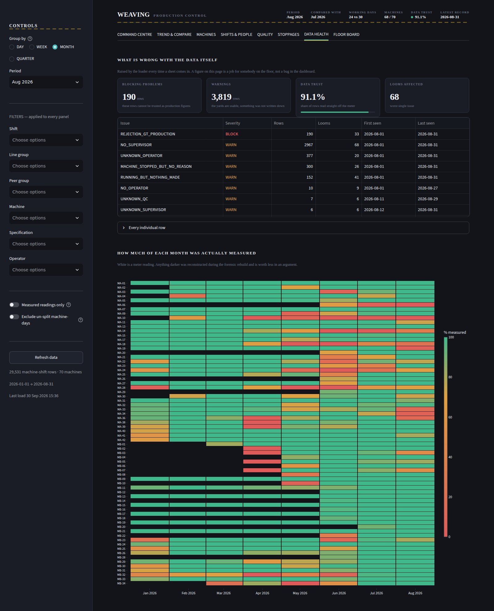
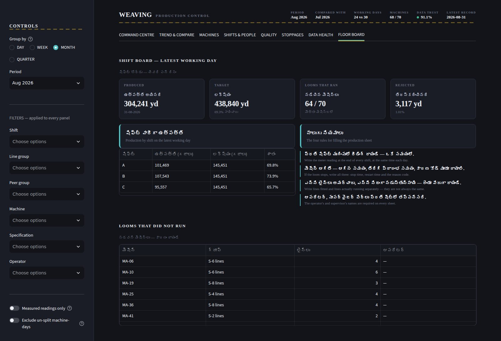
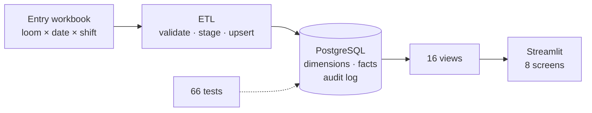

<div align="center">

# Weaving Production Intelligence

### Eight months of Excel workbooks that disagreed with each other → one reconciled record, a PostgreSQL platform and a dashboard the plant can read.

`PostgreSQL` · `Python` · `SQL` · `pandas` · `Streamlit` · `Plotly`



*Working prototype · 70 looms · 29,531 machine-shift rows · 43.6 M yards · built on-premise by one engineer*

</div>

---

## What I did

- **Found out why the numbers disagreed.** Walked the production floors, then audited the workbooks: units switched from metres to yards mid-year, gross switched to net, and a formula fault silently zeroed real production.
- **Rebuilt the record** at one grain — *one loom × one day × one shift* — with a confidence label on every row and an audit log for every correction.
- **Built the platform:** PostgreSQL schema, validating ETL, 16 views with one definition per figure, an 8-screen dashboard, and 66 automated tests.

## Results

| | |
|:--|:--|
| **43,645,373 yd** | Jan–Aug gross production, reproduced exactly from the final workbook (net 43,166,580 · efficiency 61.99 %) |
| **66 / 66** | automated checks passing on a freshly built database |
| **98.2 %** | of yards labelled MEASURED — and only 9.6 % directly metered, stated openly |
| **18 % / 82 %** | of the shortfall is target vs availability — the finding that redirected the project |

## The dashboard

<table>
<tr>
<td width="33%"></td>
<td width="33%"></td>
<td width="33%"></td>
</tr>
<tr>
<td align="center"><b>Command centre</b><br>what needs a decision</td>
<td align="center"><b>Every loom, every day</b><br>70 looms × 24 days</td>
<td align="center"><b>Quality</b><br>why ribbon is rejected</td>
</tr>
<tr>
<td width="33%"></td>
<td width="33%"></td>
<td width="33%"></td>
</tr>
<tr>
<td align="center"><b>Shifts &amp; people</b><br>shift trend, staffing what-if</td>
<td align="center"><b>Data health</b><br>can this number be trusted?</td>
<td align="center"><b>Floor board</b><br>Telugu + English</td>
</tr>
</table>

*Staff appear under aliases. Loom codes and production figures are real.*

## How it fits together



**V1** (SQLite) is where the analysis is strongest — reconciliation that *explains* differences, machine-versus-peer diagnosis, persistent underperformers. **V2** (this repo) is where the engineering is — constraints, idempotent loads, validation, tests.

## Read more

**[Case study →](docs/case-study.md)** (one page) · **[Deep dive →](docs/deep-dive/README.md)** (methodology, findings, experiments, V1 vs V2)

## Run it

```bash
pip install -r requirements.txt && cp .env.example .env      # add your database settings
psql -d weaving_db -f sql/01_schema.sql -f sql/02_views.sql
python -m etl.load --rebuild path/to/workbook.xlsx           # the plant's workbook is private
python -m tests.test_all && streamlit run app/app.py
```

`app/` dashboard · `etl/` loader · `sql/` schema and views · `tests/` 66 checks
