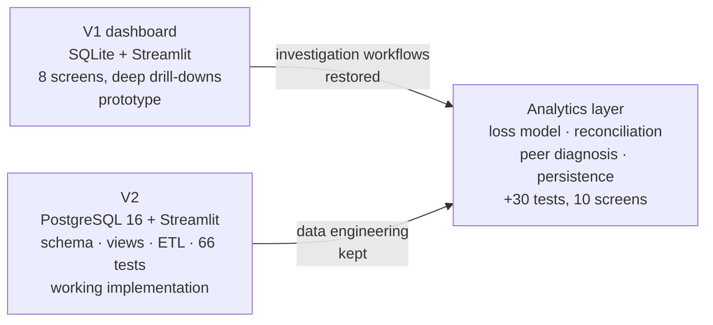
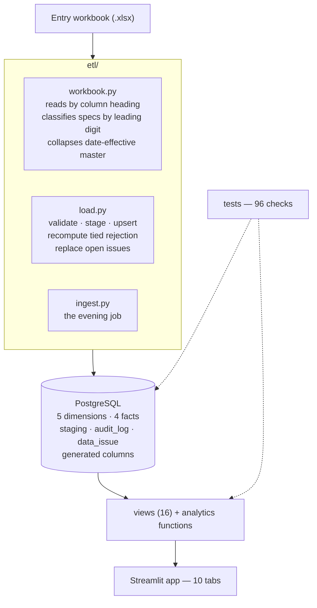

# Architecture

> The code in this repository is **V2** (8 screens, 66 tests). The analytics layer described below was built on top of it; its code is not included here.

## Generations



**V1 — the investigation prototype.** SQLite and Streamlit (about 1,000 lines of app code, 700 of queries). Eight screens with deep drill-downs: machine, peer group, shift, staff, quality, data health, and a reconciliation of the dashboard against the department's own sheet. Its job was to find out what an MD-level analysis must be able to answer. It had strong investigation workflows and weak data engineering — SQLite with no constraints, and figures computed in several places.

**V2 — the engineering implementation.** PostgreSQL 16 with 5 dimensions, 4 facts, staging, an audit log, an issue table and generated columns; 16 views (one definition per figure); an ETL that reads workbooks by heading and loads idempotently; 66 automated tests. V2 as first delivered had eight screens without drill-downs. Measured against the MD's own twelve questions, it answered two or three where V1 answered all twelve — every figure was right and the manager still could not use it. That failure is why the analytics layer exists.

**The analytics layer.** The canonical production and loss model was built first in SQL and reconciled against V1's numbers; only then were screens built on it. It adds a loss model that balances to zero under all eight accounting bases, calendar-basis targets, a peer-rate model, persistent-underperformer detection, target review, reconciliation and a recoverable-production estimate. Ten Streamlit screens sit on top, including a bilingual (Telugu under English) floor board. 30 further tests bring the total to 96.

## System



## Design rules (each came from a specific defect)

1. **One grain:** loom × date × shift. Where a day was never split into shifts in the source, `SHIFT = DAY`.
2. **Every row carries its origin:** source, confidence (MEASURED / DERIVED / UNVERIFIED / NOT APPLICABLE) and a plain-language reason.
3. **Idempotent ETL** keyed on the natural key. Re-running a load never duplicates or silently overwrites.
4. **Validation gates the core.** Rows that fail (for example rejection above production) are held at the door and listed on a Data Health view with a reason — nothing silently dropped.
5. **Tied rejection is recomputed on every load**, never trusted from the register's own column (it arrives with "YES" on every row).
6. **A row loads only if somebody typed something on it** — blank template rows must never read as looms that "did not run".
7. **Date-effective master data** — each loom carries valid-from / valid-to for line count, specification and target, so a September change cannot move August. Every production row also carries its own lines, specification and target, so history is never lost.
8. **Balance checks compare against the raw fact table**, not against the model's own total.

## Acceptance identities

```
gross − rejection = net           rejection ≤ gross
capacity − explained losses = net (balances to 0.00 under all 8 bases)
duplicate loom|date|shift = 0
```

## Constraints the design had to respect

- Runs on ordinary PCs on a LAN. No firewall, no Microsoft 365, no collaboration tools.
- Staff are non-technical; the floor board is bilingual, and everything the MD reads stays English.
- The clerk's workbook is the input.
- The schema must absorb changeovers, resets, new specifications, joiners and leavers without a rebuild.

## Entry workbook and paper form

- **Paper form v1.2** (bilingual, printable and editable): adds lines running, opening/closing reading, stop/restart times and a 12-code reason list — six new boxes, because four of the five missing fields were a habit problem, not a system problem.
- **Entry workbook** (shift grain) covering 1 September – 31 December 2026: 20,874 rows (down from 51,000) and 11 MB (down from 20 MB); calculated columns hidden so the clerk sees 24 of 44; history stored as values and future rows as formulas. It recalculates 445,358 formulas with zero errors and reproduces September 1–17 net production at 4,024,011 yards.
