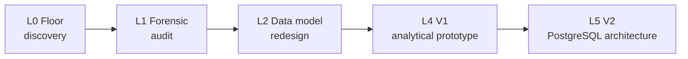

# Build log — the layers that were completed

The project was tracked in Notion as a stack of build layers, each with the process before it, what was done, what it produced, and what it exposed for the next one. This is the completed part of that record.

**Governing principle (set in the first layer):** understand the process first, then design the data system. No structure, database or dashboard was designed before the process was understood on the floor.

**Architectural principle:** every technology introduced must remove manual work, reduce operational risk, improve traceability, or create a capability the current stack cannot reasonably provide. A technology that satisfies none of these does not enter the system, however capable it is.

*Effort figures are my own estimates (ranges) from the project log; no time-tracking system existed.*

## L0 · Origin and discovery — 40 h
**Before:** production was written by hand at the loom, carried to the office and typed into several Excel files; weekly and monthly figures were rebuilt by copying between sheets; nobody had mapped how a number reached a management report.
**Done:** observed the process on the floors across shifts; studied the manual logbooks; reviewed the SOPs; held structured discussions with floor HODs and production managers; established how meter readings, production, rejection, machine changes, resets and stoppages are recorded, by whom and when; collected the existing files.
**Produced:** the recording process written down end to end; an inventory of every production file and format; a list of discrepancies nobody on the floor could explain.
**Why it matters:** the grain the whole system uses — loom × date × shift — came from how the floor already works, not from a modelling preference. **Exposed:** files that disagreed in ways nobody could explain → L1.

## L1 · Forensic data audit — 119–141 h (the largest layer)
**Before:** the Excel files were the only record of history — wide format, one row per day and one column per machine, edited in place, with no key, no history and no way to tell a correction from a fresh entry.
**Done:** row-level examination of the workbooks; traced individual machine-day values back through the sheets; catalogued each defect class; recomputed the original summaries on a defined basis and compared; raised discrepancies with the floor; kept an audit log of every correction and its reason.
**Defect classes:** overwritten machine values · merged machine records · duplicate rows · copy-paste dependency · inconsistent daily formats · unrepresented resets and changeovers.
**Produced:** the defect catalogue, the audit log, a reconciliation basis (how to compare a recomputed figure with the department's), and a list of discrepancies the floor could not explain.
**Why it matters:** every number in the system descends from this. It is also why the later PostgreSQL rebuild took roughly 40 hours rather than months. **Exposed:** the defects were caused by the wide-format sheet itself → L2.

## L2 · Data model redesign — 44–52 h
**Decision:** one row = one loom × one date × one shift.
**Done:** defined the grain; designed the long-format structure and separated master data from transactions; built and revised several prototype workbooks, each tested against the previous; recomputed the restructured data against the department summaries; investigated the residuals instead of forcing a match.
**Produced:** a long-format dataset at one grain; master data separated (machine, specification, people, reason codes); structured entry templates for production, rejection, stoppage and QC.
**Why it took this long:** the structure was not the hard part — proving it was. Several versions were built and discarded before one held. **Exposed:** a sound structure is worth nothing if what arrives each day is inconsistent → controlled capture (the entry workbook and paper form).

## L4 · V1 analytical prototype — 80–88 h
**Purpose:** find out what the restructured data could actually explain, before committing to an architecture.
**Built:** an SQLite database from the long-format dataset, an analytical query layer in Python (`queries.py`), and a dashboard application (`app.py`) — Command Centre, machine analysis with peer comparison, shift, people and quality analysis with a rejection Pareto, trends, production-loss attribution and waterfall, reconciliation against the department figures with a stated accounting basis, persistent-underperformer identification, and data-health analysis.
**What it proved:** the system can explain *why* a target was missed — which machine, which shift, which reason, how much each contributed. *A dashboard that shows the gap is reporting; a dashboard that accounts for the gap, line by line, is a decision system.*
**Why it took this long:** most of the time went into the analytical logic, not the interface — defining loss attribution so the waterfall balances, deciding the accounting basis for targets and rejection, making reconciliation *explain* a difference rather than display it. **Exposed:** strong analysis on a weak foundation — a file-based database, manual loading, no schema separation, no roles → L5.

## L5 · V2 engineering architecture — 35–43 h
**Decision (the engineer's own call, mid-project):** the analysis would not survive on a file-based foundation; rebuild on PostgreSQL. *Better to rebuild at nine layers than at fifteen.*
**Built:** a PostgreSQL instance with schema separation; normalised fact and dimension tables; an ETL pipeline; validation at load; roles; data-health monitoring; confidence and provenance fields on every production record; stop-and-restart event capture; specification-level aggregation; target review; the audit log; the operational entry workflow and a bilingual floor board.
**Also:** the forensic audit was re-run from the original sheets against the established long-format dataset, carrying the 98 %+ agreement forward.
**Why it took so little:** *the audit cost 119–141 h; the architecture it enabled cost 35–43 h.* The grain, master data, reason codes and reconciliation method were already decided and proven, so the build was mechanical rather than exploratory. That ratio is the argument for doing the foundation work first.
**The trade this layer created:** V1 had the intelligence and no foundation; V2 had the foundation and, at first, not the intelligence — which is why the analytics layer was built next (see [v1-v2-comparison.md](v1-v2-comparison.md)).

## Decisions that shaped it

| Decision | Reason |
|---|---|
| Rebuild on PostgreSQL rather than continue on SQLite | No constraints, figures computed in several places, no roles or audit trail; a second person could not have run it |
| Every fact row carries source, confidence and load batch | So any figure can say where it came from and how far it can be trusted |
| Investigate residual differences rather than force a match to the old summaries | A reconciliation that always balances proves nothing |
| Explain the gap instead of reporting it | Target − actual must equal the sum of explained losses |
